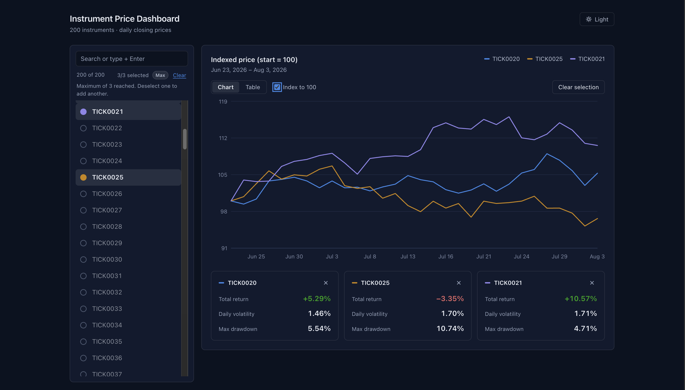

# Instrument Price Dashboard

A full-stack app for browsing instruments, viewing 30-day price charts, and seeing basic statistics. Backend is C# / .NET (minimal API); frontend is React + TypeScript (Vite) with Recharts.

The exercise brief is in [docs/REQUIREMENTS.md](docs/REQUIREMENTS.md) ([original PDF](docs/Take_Home_Instrument_Dashboard.pdf)).

## Prerequisites

- [.NET SDK](https://dotnet.microsoft.com/download) (any current version)
- Node.js (for the frontend)

## Running the backend

```bash
cd backend
dotnet run
```

The API serves on `http://localhost:5080`. The CSV is loaded and validated once at startup (no database); a malformed file stops the app with a descriptive error.

- **Swagger UI:** `http://localhost:5080/swagger` (Development only)
- **Health check:** `http://localhost:5080/health`

Run the tests from the repo root:

```bash
dotnet test
```

## Backend structure

```
backend/
  Controllers/   thin HTTP layer (InstrumentsController, PricesController)
  Services/      IPriceRepository + in-memory impl, CsvPriceLoader, IStatsCalculator
  Models/        PricePoint, TickerStats
  Options/       strongly typed, validated config (Data, Cors)
  Extensions/    DI / CORS / Swagger registration
tests/Backend.Tests/   unit tests (stats, CSV loader) and API integration tests
```

Configuration lives in `appsettings.json` (`Urls`, `Data:CsvPath`, `Cors:AllowedOrigins`) and can be overridden with environment variables, e.g. `Cors__AllowedOrigins__0`.

## Running the frontend

In a second terminal, with the backend running:

```bash
cd frontend
npm install
npm run dev
```

Open `http://localhost:5173`. The frontend calls the API at `http://localhost:5080`; set `VITE_API_URL` in `frontend/.env` to change it.



Features: search-as-you-type ticker list, price line chart with stats (total return, volatility, max drawdown), loading/error states (including API unreachable and unknown ticker), and multi-select of up to 3 tickers overlaid on one chart. An "Index to 100" option rebases each series to 100 so tickers at different price levels are easier to compare, and a Table view shows the exact values behind the chart. Enter in the search box selects tickers by typing, including comma-separated lists such as `0001, 0002`. Light and dark themes are available (dark by default).

## Frontend tests

```bash
cd frontend
npm test            # run once (71 tests, about a second)
npm run test:watch  # re-run on change
```

Built with [Vitest](https://vitest.dev) and [React Testing Library](https://testing-library.com/docs/react-testing-library/intro/) in a jsdom environment. No backend needs to be running: the API client is mocked.

### What is covered

| Area | File | Tests |
| --- | --- | --- |
| Ticker matching (exact name, number such as `1` vs `10`, unique partial match, filtering on the last comma token) and Enter / comma selection (what is added, what stays in the box, when the limit is hit) | `src/tickerSearch.test.ts` | 14 |
| Stable series colors: deselecting one ticker never repaints another | `src/selection.test.ts` | 5 |
| Chart data: merging series by date, Index to 100 rescaling, date formatting | `src/chartData.test.ts` | 5 |
| API client: JSON parsing, URL encoding, `ProblemDetails` messages, unreachable API | `src/api.test.ts` | 5 |
| Stat tiles: signed returns, loading, error + retry, remove | `src/components/StatsPanel.test.tsx` | 6 |
| Ticker list: toggling, disabled rows at the limit, empty search | `src/components/TickerList.test.tsx` | 5 |
| Table view | `src/components/PriceTable.test.tsx` | 4 |
| Data-loading hook: caching, in-flight state, errors, retry | `src/hooks/useTickerData.test.tsx` | 5 |
| Whole-app flows: instrument loading and error + Retry, search, select, Enter and comma lists, the 3-ticker limit and Max badge, three ways to clear, Chart/Table, Index to 100, dark default and theme toggle | `src/App.test.tsx` | 22 |

### How they are written

- **Test what the user sees.** Queries use roles and accessible names (`getByRole('checkbox', { name: 'TICK0001' })`), not CSS classes or component internals, so tests survive refactors and double as a light accessibility check.
- **Logic lives outside components.** Ticker matching, selection planning and color-slot assignment are plain functions in `src/tickerSearch.ts` and `src/selection.ts`, so they are tested directly without rendering anything.
- **The API is mocked at the module boundary** (`vi.mock('./api')`) in the `App` and hook tests, with fixtures in `src/test/fixtures.ts`. Global setup is in `src/test/setup.ts`.
- **Tests sit next to the code** they cover, named `*.test.ts` / `*.test.tsx`.

### Limits

- The Recharts line chart is stubbed in the `App` tests. It needs real browser layout, which jsdom does not provide, so the chart's rendering (lines, tooltip, axes) is not covered; its data is (`chartData.test.ts`).
- There are no end-to-end browser tests, and no visual or styling checks.
- To check the tests actually catch regressions, I deliberately broke the code in four places (color slots, the `+` sign on returns, keeping typed text, and enforcing the limit) and confirmed the relevant tests failed each time.

## API

| Method | Route | Returns |
| --- | --- | --- |
| GET | `/api/instruments` | List of all 200 tickers |
| GET | `/api/prices/{ticker}` | Full 30-day price series (404 if unknown) |
| GET | `/api/prices/{ticker}/stats` | Total return %, daily volatility %, max drawdown % (404 if unknown) |

## Stats definitions

- **Total return %** = (last price / first price - 1) x 100
- **Daily volatility** = sample standard deviation (n-1) of simple daily returns (p[i] / p[i-1] - 1), reported as a percent
- **Max drawdown** = largest peak-to-trough decline over the window, reported as a positive percent (13.4 means a 13.4% decline)

### How max drawdown is calculated

One pass over the closing prices in date order, tracking the running peak:

```
peak = first price
for each price:
    peak = max(peak, price)
    drawdown = (peak - price) / peak
max drawdown = largest drawdown seen
```

Example: prices 100, 200, 100, 150, 190 peak at 200 and later fall to 100, a 50% drawdown. The later recovery to 190 does not reduce it. A series that only rises has a drawdown of 0. Only closing prices are used, so intraday moves are not captured.

Ticker lookup is case-insensitive. Errors use RFC 7807 `ProblemDetails` (e.g. `{"title":"Unknown ticker","status":404,"detail":"Unknown ticker 'NOPE'"}`).

## Design notes

- Port 5080 is used because macOS reserves port 5000 for AirPlay Receiver.
- CORS is enabled only for GET requests from the configured origins (default: `localhost:5173` and `localhost:3000`).

## Use of AI assistance

I used Claude to help set up the .NET project on macOS and to draft the backend and React frontend code, including the backend and frontend tests. I verified the stats output against an independent Python calculation on the same data.
